# Diagram Sistem - Inheartz Studio

Dokumen ini menampilkan seluruh diagram sistem dalam format **Mermaid** agar mudah dibaca, dipresentasikan, dan dirender di GitHub, GitLab, VS Code, dan viewer Markdown lain.

> Sumber asli juga tersedia: PlantUML (`.puml`) untuk UML & HIPO, serta DBML (`.dbml`) untuk ERD. Lihat tabel [Berkas Sumber](#berkas-sumber) di bawah.
>
> **Versi Dokumen: 0.2.0**
>
> **Catatan:** Diagram ini disusun untuk tampilan yang lebih rapi dan mudah dicerna saat dipakai untuk review produk, demo, atau laporan tugas.

## Overview Arsitektur

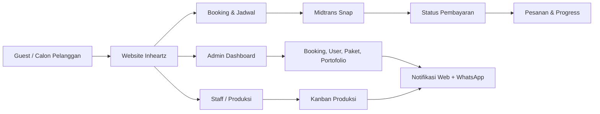

Daftar isi:
1. [Use Case Diagram](#1-use-case-diagram)
2. [Activity Diagram](#2-activity-diagram)
3. [Class Diagram](#3-class-diagram)
4. [ERD (Entity Relationship Diagram)](#4-erd-entity-relationship-diagram)
5. [State Diagram Status Booking](#5-state-diagram-status-booking)
6. [State Diagram Status Pembayaran](#6-state-diagram-status-pembayaran)
7. [Flowchart Alur Web (Navigasi, Booking, Pembayaran, Peran)](#7-flowchart-alur-web-navigasi-booking-pembayaran-peran)
8. [Flowchart Penanganan Gagal Database](#8-flowchart-penanganan-gagal-database)
9. [HIPO - Hierarchy Chart](#9-hipo---hierarchy-chart)
10. [HIPO - Input / Process / Output (IPO)](#10-hipo---input--process--output-ipo)

---

## 1. Use Case Diagram

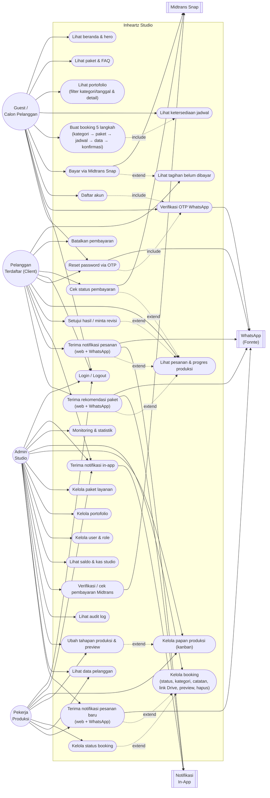

---

## 2. Activity Diagram

Activity diagram dipisah per aktor agar alurnya 1-1 sesuai aksi yang dilakukan aktor dan fitur yang tersedia. Versi gabungan (swimlane) tetap tersedia di `activity.puml`.

### 2.1 Activity Diagram - Guest / Client

Alur: jelajah publik → autentikasi/OTP → booking → pembayaran Midtrans → pesanan/review → notifikasi web + WhatsApp → rekomendasi paket.

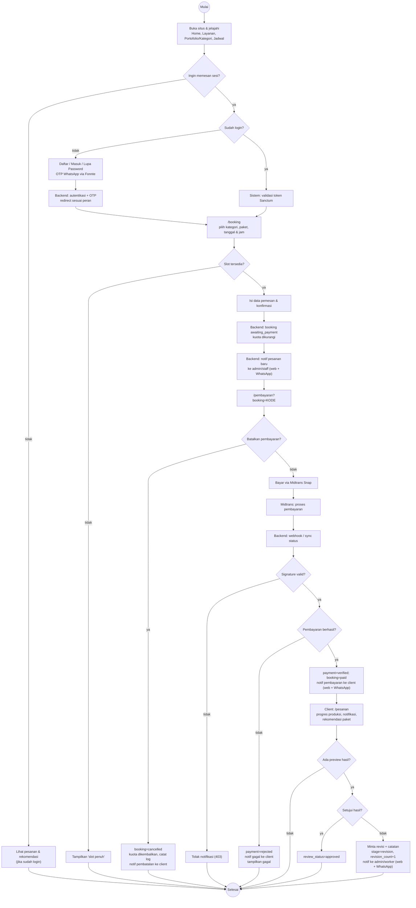

### 2.2 Activity Diagram - Admin

Alur: login → notifikasi pesanan baru → dashboard → kelola booking → produksi → pelanggan → user → paket → portofolio → audit log.

```mermaid
flowchart TD
    start((Mulai)) --> login["Admin: /masuk"]
    login --> auth["Backend: autentikasi Sanctum<br/>role=admin"]
    auth --> redirect["Sistem: redirect /admin"]
    redirect --> dash["Buka dashboard monitoring<br/>statistik, revenue, saldo & kas"]
    dash --> notify["Terima notifikasi pesanan baru<br/>(bell/toast + WhatsApp)"]
    notify --> bookingQ{"Kelola booking?"}
    bookingQ -- ya --> bookings["/admin/bookings<br/>filter/cari, ubah status, kategori, catatan,<br/>link Drive, preview, hapus"]
    bookings --> save["Backend: simpan perubahan<br/>catat audit log + notif status<br/>ke client (web + WhatsApp)"]
    save --> verify["Admin: verifikasi / cek pembayaran Midtrans"]
    verify --> prodQ{"Kelola produksi?"}
    bookingQ -- tidak --> prodQ
    prodQ -- ya --> prod["/admin/production<br/>kanban queued → transfer → culling →<br/>editing → review → revision → delivered"]
    prod --> preview["Unggah preview hasil & estimasi"]
    preview --> notif["Backend: simpan booking_progress<br/>notif progres ke client (web + WhatsApp)"]
    notif --> custQ{"Kelola pelanggan?"}
    prodQ -- tidak --> custQ
    custQ -- ya --> cust["/admin/customers<br/>lihat data pelanggan"]
    cust --> userQ{"Kelola user?"}
    custQ -- tidak --> userQ
    userQ -- ya --> users["/admin/users<br/>kelola user & role"]
    users --> pkgQ{"Kelola paket?"}
    userQ -- tidak --> pkgQ
    pkgQ -- ya --> pkgs["/admin/packages<br/>CRUD paket layanan"]
    pkgs --> portQ{"Kelola portofolio?"}
    pkgQ -- tidak --> portQ
    portQ -- ya --> ports["/admin/portfolios<br/>CRUD portofolio"]
    ports --> auditQ{"Lihat audit log?"}
    portQ -- tidak --> auditQ
    auditQ -- ya --> audit["/admin/audit-logs<br/>riwayat perubahan"]
    audit --> stop0((Selesai))
    auditQ -- tidak --> stop0
```

### 2.3 Activity Diagram - Worker Produksi

Alur: login → notifikasi pesanan baru → dashboard produksi → kanban → status booking → data pelanggan.

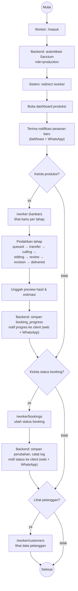

### 2.4 Overview Gabungan (Swimlane)

Alur web end-to-end semua aktor dalam satu diagram. Ini versi ringkas; untuk alur per aktor lihat 2.1–2.3.

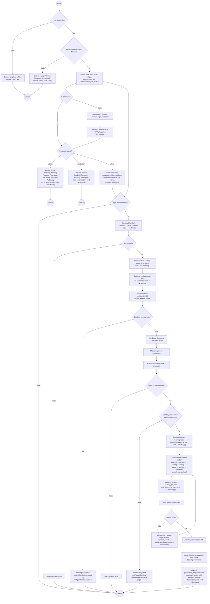

---

## 3. Class Diagram

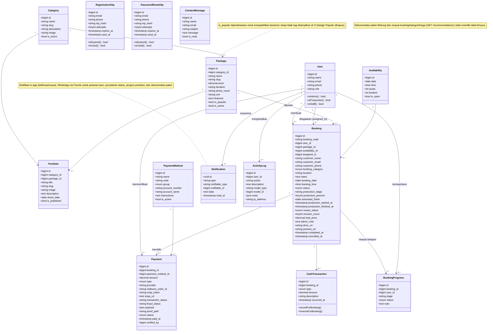

---

## 4. ERD (Entity Relationship Diagram)

Struktur mengikuti migrasi Laravel. Versi interaktif (dbdiagram.io): [`erd.dbml`](./erd.dbml).

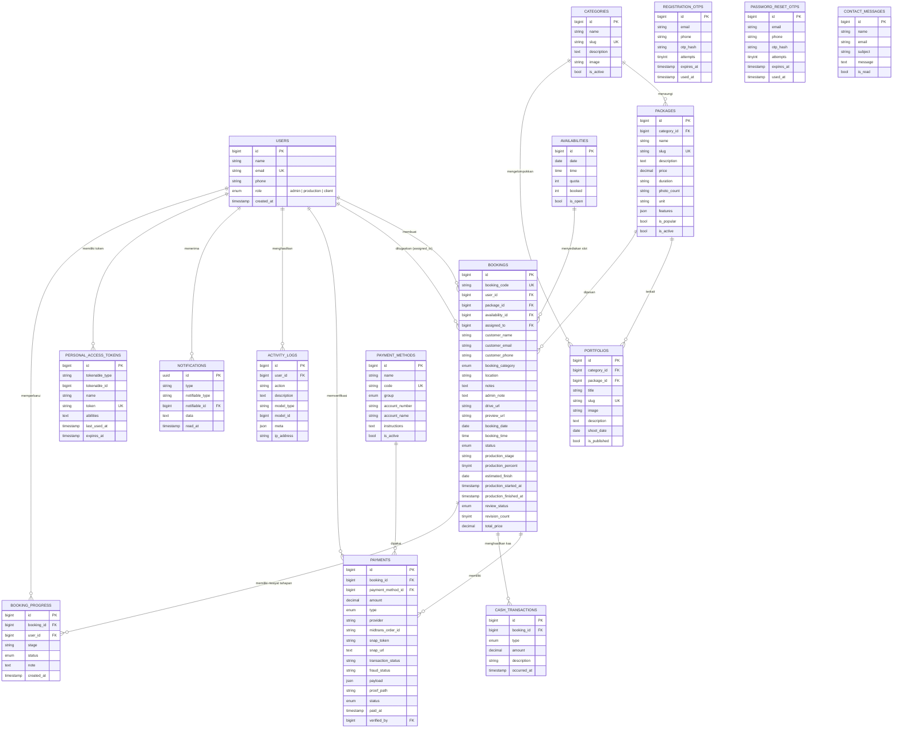

> Catatan: kolom `PACKAGES.is_popular` tetap ada untuk kompatibilitas backend, tetapi sejak versi 0.1.7 tidak lagi digunakan/ditampilkan di UI. Kolom `BOOKINGS.booking_category` (`personal` | `event` | `corporate_umkm`, default `personal`) membagi pesanan menjadi Personal, Event, serta Corporate & UMKM; pelanggan memilihnya di langkah pertama booking dan admin dapat mengubahnya. Rekomendasi paket (`GET /recommendations`) bersifat turunan dan tidak memerlukan tabel baru. Notifikasi WhatsApp dikirim via Fonnte tanpa tabel terpisah.

---

## 5. State Diagram Status Booking

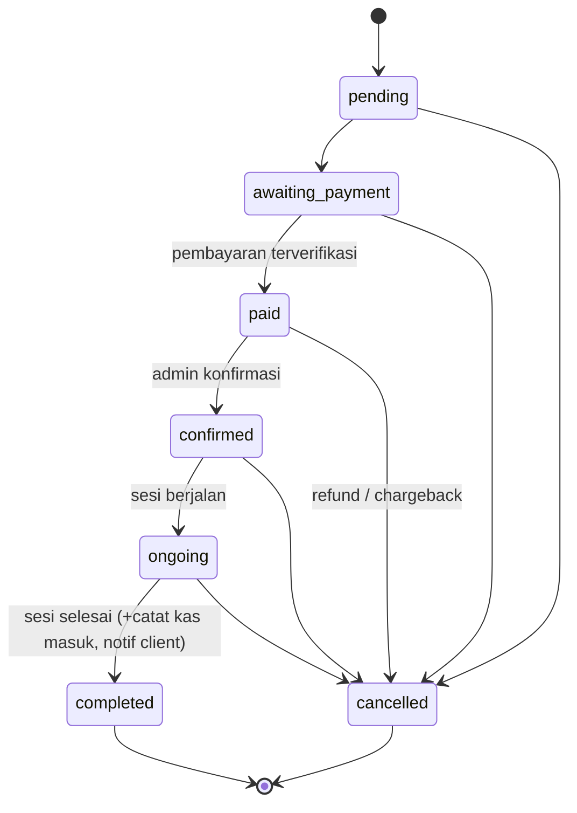

> Setiap perubahan status mengirim notifikasi ke pelanggan melalui web (bell/toast) dan WhatsApp (Fonnte).

---

## 6. State Diagram Status Pembayaran

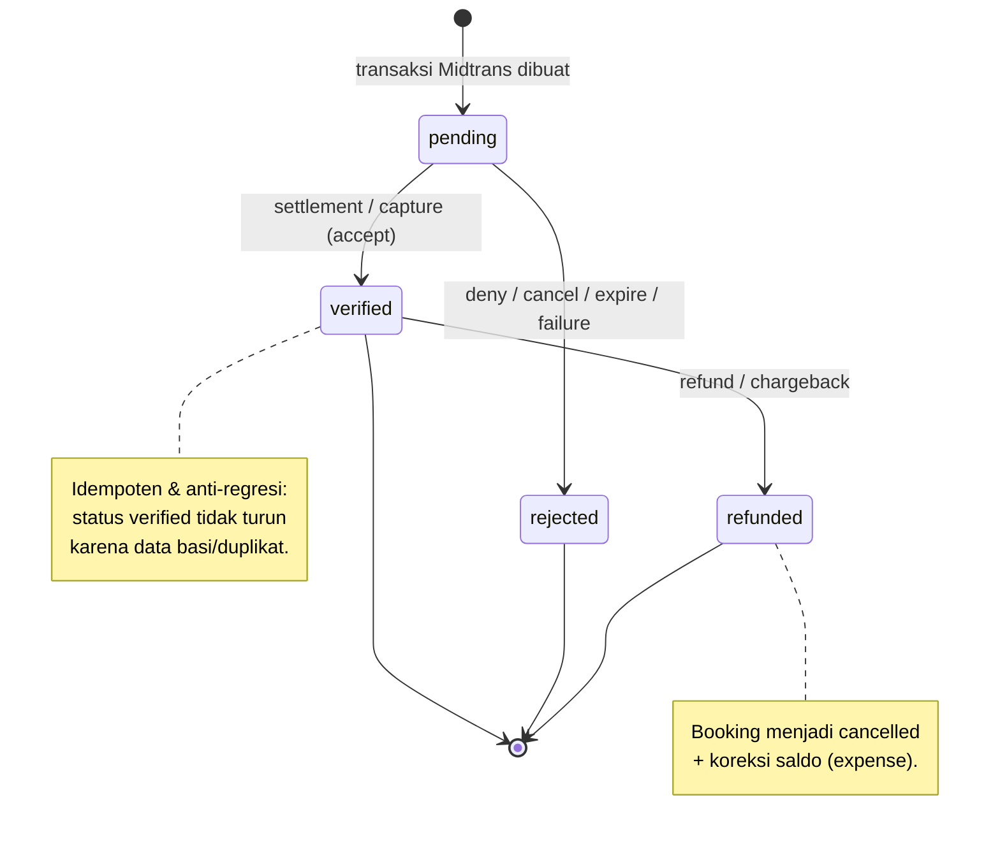

---

## 7. Flowchart Alur Web (Navigasi, Booking, Pembayaran, Peran)

Alur navigasi web: halaman publik → booking/pembayaran → pesanan client, serta redirect berbasis peran ke dashboard admin atau produksi. Alur produksi internal dirinci pada Activity Diagram.

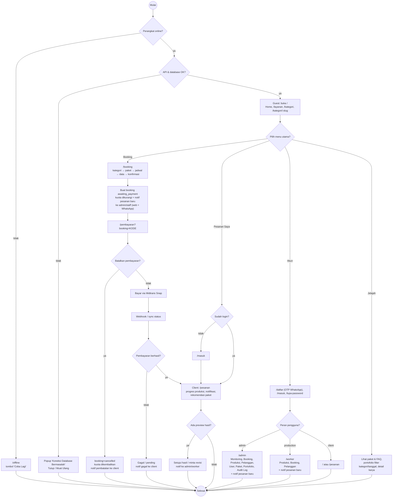

---

## 8. Flowchart Penanganan Gagal Database

Alur ketika frontend gagal mengakses API/database. Berlaku untuk seluruh dashboard admin, produksi, dan halaman publik yang memuat data.

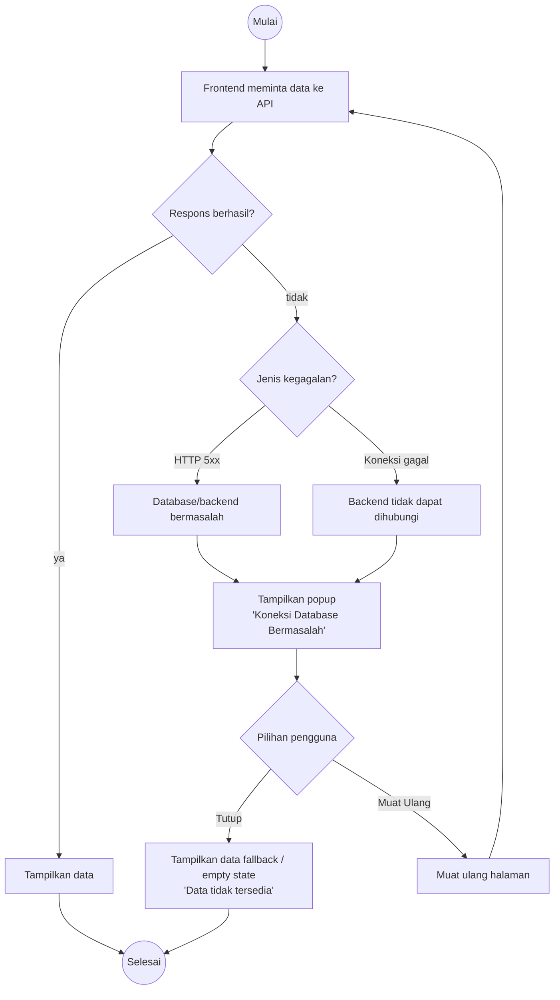

Catatan implementasi:
- Event global `inheartz:db-error` dikirim oleh `services/http.js` saat HTTP 5xx atau koneksi gagal.
- Komponen `components/DatabaseAlert.jsx` menampilkan popup dengan tombol **Tutup** dan **Muat Ulang**.
- Service tetap memakai fallback `data/store.js` / `data/mock.js`, dan halaman menampilkan empty state bila data kosong.

---

## 9. HIPO - Hierarchy Chart

Hierarchy Chart (H Chart) menunjukkan dekomposisi modul sistem dari level tertinggi ke submodul. Versi PlantUML: [`hipo-hierarchy.puml`](./hipo-hierarchy.puml).

```mermaid
flowchart TD
    ROOT["Inheartz Studio<br/>(Sistem Web)"]

    ROOT --> M1["1. Modul Publik"]
    ROOT --> M2["2. Modul Akun & Autentikasi"]
    ROOT --> M3["3. Modul Booking"]
    ROOT --> M4["4. Modul Pembayaran & Kas"]
    ROOT --> M5["5. Modul Produksi"]
    ROOT --> M6["6. Modul Pesanan & Review"]
    ROOT --> M7["7. Modul Notifikasi & Rekomendasi"]
    ROOT --> M8["8. Modul Dashboard Admin"]
    ROOT --> M9["9. Modul Dashboard Produksi"]
    ROOT --> M10["10. Modul Infrastruktur & Ketahanan"]

    M1 --> M1a["1.1 Beranda & Hero"]
    M1 --> M1b["1.2 Layanan / Paket & FAQ"]
    M1 --> M1c["1.3 Portofolio & Kategori"]
    M1 --> M1d["1.4 Jadwal & Ketersediaan"]

    M2 --> M2a["2.1 Login"]
    M2 --> M2b["2.2 Daftar Akun + OTP WhatsApp"]
    M2 --> M2c["2.3 Lupa Password + OTP WhatsApp"]
    M2 --> M2d["2.4 Profil & Logout"]
    M2 --> M2e["2.5 RBAC & Proteksi Rute"]

    M3 --> M3a["3.1 Pilih Kategori Booking"]
    M3 --> M3b["3.2 Pilih Paket"]
    M3 --> M3c["3.3 Kalender & Slot Jam"]
    M3 --> M3d["3.4 Data Pemesan"]
    M3 --> M3e["3.5 Konfirmasi & Buat Booking"]
    M3 --> M3f["3.6 Batalkan Booking"]

    M4 --> M4a["4.1 Tagihan Menunggu Pembayaran"]
    M4 --> M4b["4.2 Midtrans Snap"]
    M4 --> M4c["4.3 Webhook / Sync / Rekonsiliasi"]
    M4 --> M4d["4.4 Cek Status Pembayaran"]
    M4 --> M4e["4.5 Ledger Kas (Income / Expense)"]

    M5 --> M5a["5.1 Papan Kanban"]
    M5 --> M5b["5.2 Update Tahapan & Persentase"]
    M5 --> M5c["5.3 Estimasi Selesai"]
    M5 --> M5d["5.4 Preview Hasil"]
    M5 --> M5e["5.5 Riwayat Progres"]

    M6 --> M6a["6.1 Progress Pesanan"]
    M6 --> M6b["6.2 Setujui Hasil"]
    M6 --> M6c["6.3 Minta Revisi"]
    M6 --> M6d["6.4 Hasil Akhir (Google Drive)"]

    M7 --> M7a["7.1 Notifikasi In-App (Bell / Toast / Suara)"]
    M7 --> M7b["7.2 Notifikasi WhatsApp (Fonnte)"]
    M7 --> M7c["7.3 Rekomendasi Paket"]

    M8 --> M8a["8.1 Monitoring & Statistik"]
    M8 --> M8b["8.2 Finance / Saldo"]
    M8 --> M8c["8.3 Booking"]
    M8 --> M8d["8.4 Pelanggan"]
    M8 --> M8e["8.5 User & Role"]
    M8 --> M8f["8.6 Paket"]
    M8 --> M8g["8.7 Portofolio"]
    M8 --> M8h["8.8 Audit Log"]

    M9 --> M9a["9.1 Kanban Produksi"]
    M9 --> M9b["9.2 Booking (Ubah Status)"]
    M9 --> M9c["9.3 Pelanggan"]

    M10 --> M10a["10.1 Offline Gate"]
    M10 --> M10b["10.2 Database Alert"]
    M10 --> M10c["10.3 Polling & Sinkronisasi"]
    M10 --> M10d["10.4 Fallback Mock / Local Store"]
```

---

## 10. HIPO - Input / Process / Output (IPO)

IPO Chart memisahkan **Input → Process → Output** untuk setiap modul. Versi PlantUML: [`hipo-ipo.puml`](./hipo-ipo.puml).

```mermaid
flowchart TB
    subgraph M1["1. Modul Publik"]
        direction LR
        I1["INPUT<br/>Konten paket, kategori,<br/>portofolio, FAQ<br/>Tanggal pencarian jadwal"] --> P1["PROCESS<br/>Render katalog & hero<br/>Filter kategori / tanggal<br/>Cek ketersediaan slot"] --> O1["OUTPUT<br/>Halaman publik<br/>Daftar paket & galeri<br/>Slot jadwal tersedia"]
    end

    subgraph M2["2. Modul Akun & Autentikasi"]
        direction LR
        I2["INPUT<br/>Nama, email, password<br/>Nomor WhatsApp<br/>Kode OTP"] --> P2["PROCESS<br/>Validasi kredensial<br/>Kirim / verifikasi OTP via Fonnte<br/>Buat sesi token & cek role"] --> O2["OUTPUT<br/>Token Sanctum<br/>Sesi login<br/>Redirect sesuai peran<br/>Akun client baru"]
    end

    subgraph M3["3. Modul Booking"]
        direction LR
        I3["INPUT<br/>Kategori booking<br/>Paket, tanggal, jam<br/>Data pemesan<br/>Kuota slot"] --> P3["PROCESS<br/>Validasi kategori & kuota<br/>Buat booking awaiting_payment<br/>Kurangi kuota slot"] --> O3["OUTPUT<br/>Kode booking + kategori<br/>Status awaiting_payment<br/>Tagihan pembayaran<br/>Notif pesanan baru"]
    end

    subgraph M4["4. Modul Pembayaran & Kas"]
        direction LR
        I4["INPUT<br/>Booking ID & nominal<br/>Transaksi Midtrans<br/>Webhook & signature<br/>Status order"] --> P4["PROCESS<br/>Charge Midtrans Snap<br/>Verifikasi signature SHA512<br/>Sync / rekonsiliasi status<br/>Idempoten & anti-regresi"] --> O4["OUTPUT<br/>Payment verified / rejected / refunded<br/>Booking paid / cancelled<br/>Kas income / expense<br/>Notif pembayaran"]
    end

    subgraph M5["5. Modul Produksi"]
        direction LR
        I5["INPUT<br/>Booking berstatus paid<br/>Tahapan & catatan<br/>Estimasi selesai<br/>Preview URL"] --> P5["PROCESS<br/>Update stage / progress<br/>Hitung persentase<br/>Simpan riwayat booking_progress"] --> O5["OUTPUT<br/>Kanban ter-update<br/>Riwayat progres<br/>Notif progres ke client"]
    end

    subgraph M6["6. Modul Pesanan & Review"]
        direction LR
        I6["INPUT<br/>User login & daftar booking<br/>Preview hasil<br/>Keputusan review<br/>Catatan revisi"] --> P6["PROCESS<br/>Tampilkan progress<br/>Setujui hasil / minta revisi<br/>Hitung revision_count<br/>Pindah stage revisi"] --> O6["OUTPUT<br/>review_status approved / revision<br/>Notif ke admin/worker<br/>Progress & hasil akhir"]
    end

    subgraph M7["7. Modul Notifikasi & Rekomendasi"]
        direction LR
        I7["INPUT<br/>Event pesanan / status / progres<br/>Riwayat booking, kategori, harga"] --> P7["PROCESS<br/>Buat notifikasi in-app<br/>Kirim WhatsApp via Fonnte<br/>Hitung rekomendasi paket"] --> O7["OUTPUT<br/>Bell / toast / suara<br/>Pesan WhatsApp<br/>Daftar rekomendasi di /pesanan"]
    end

    subgraph M8["8. Modul Dashboard Admin"]
        direction LR
        I8["INPUT<br/>Data booking & pembayaran<br/>Data user, paket, portofolio<br/>Audit trail"] --> P8["PROCESS<br/>Agregasi statistik & saldo<br/>Filter / cari<br/>CRUD & verifikasi pembayaran<br/>Catat audit log"] --> O8["OUTPUT<br/>Monitoring & grafik<br/>Saldo / kas studio<br/>Tabel kelola & audit log"]
    end

    subgraph M9["9. Modul Dashboard Produksi"]
        direction LR
        I9["INPUT<br/>Antrean produksi<br/>Data booking<br/>Data pelanggan<br/>Role production"] --> P9["PROCESS<br/>Drag & drop tahapan<br/>Ubah status booking<br/>Lihat data pelanggan"] --> O9["OUTPUT<br/>Progres ter-update<br/>Status tersinkron ke admin<br/>Notif perubahan ke client"]
    end

    subgraph M10["10. Modul Infrastruktur & Ketahanan"]
        direction LR
        I10["INPUT<br/>Status online perangkat<br/>Respons API / database<br/>Event error"] --> P10["PROCESS<br/>Deteksi offline<br/>Tangkap HTTP 5xx / koneksi gagal<br/>Fallback mock & polling"] --> O10["OUTPUT<br/>Halaman /offline<br/>Popup database<br/>Empty state & data tersinkron"]
    end
```

---

## Berkas Sumber

| Diagram | Berkas sumber | Format / Cara render |
| --- | --- | --- |
| Use Case | [`usecase.puml`](./usecase.puml) | PlantUML — <https://www.plantuml.com/plantuml/uml> |
| Activity (overview) | [`activity.puml`](./activity.puml) | PlantUML |
| Activity Guest/Client | [`activity-client.puml`](./activity-client.puml) | PlantUML |
| Activity Admin | [`activity-admin.puml`](./activity-admin.puml) | PlantUML |
| Activity Worker | [`activity-worker.puml`](./activity-worker.puml) | PlantUML |
| Class | [`class.puml`](./class.puml) | PlantUML |
| Flowchart | [`flowchart.puml`](./flowchart.puml) | PlantUML |
| ERD | [`erd.dbml`](./erd.dbml) | dbdiagram.io — **Import → DBML** |
| HIPO Hierarchy | [`hipo-hierarchy.puml`](./hipo-hierarchy.puml) | PlantUML |
| HIPO IPO | [`hipo-ipo.puml`](./hipo-ipo.puml) | PlantUML |
| EERD (Mermaid) | [`../eerd.md`](../eerd.md) | Mermaid |

Petunjuk render lengkap: [README.md](./README.md). Dokumen terkait: [../prd.md](../prd.md).
