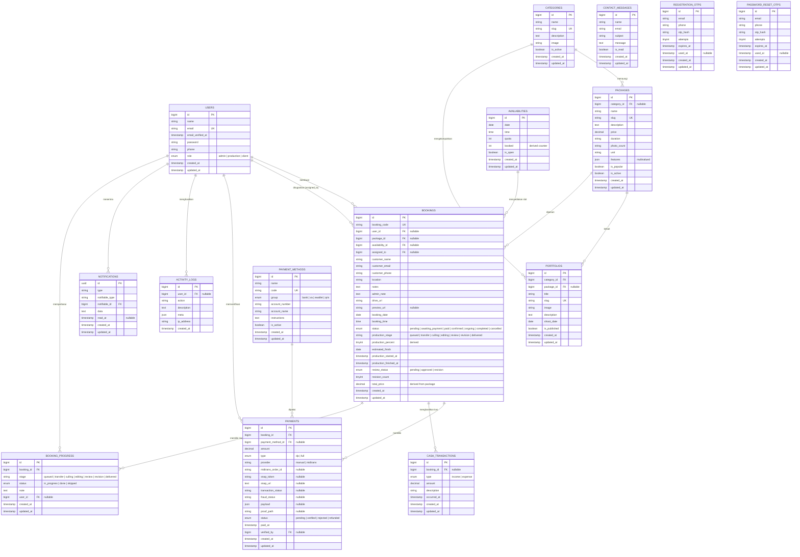
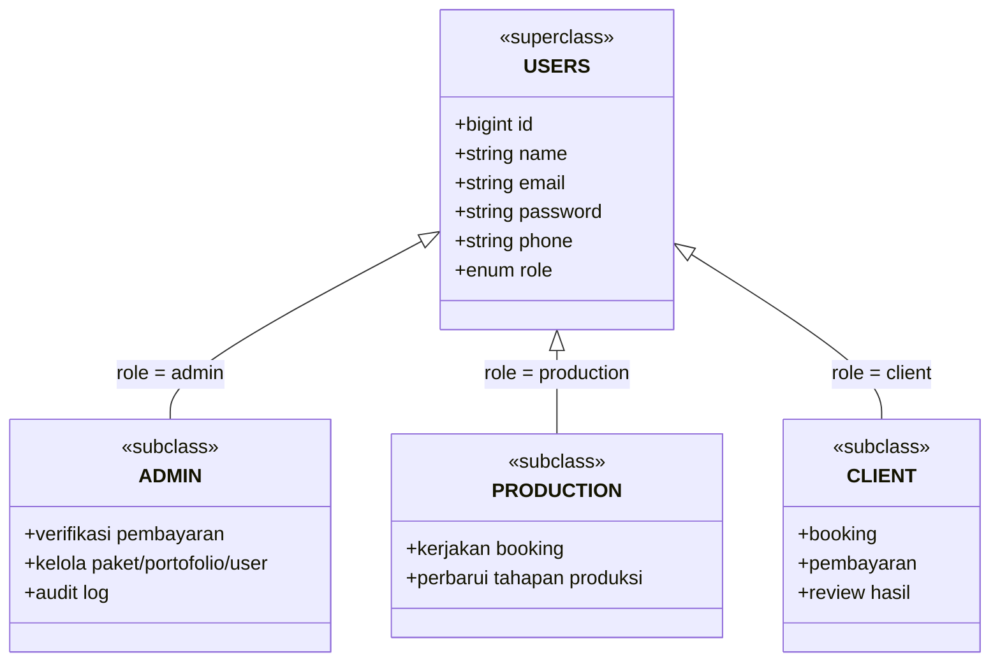
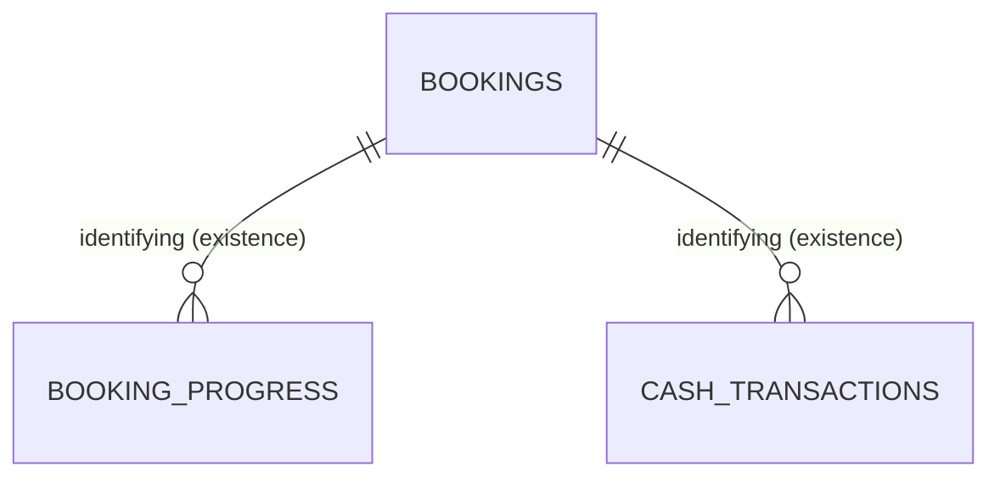
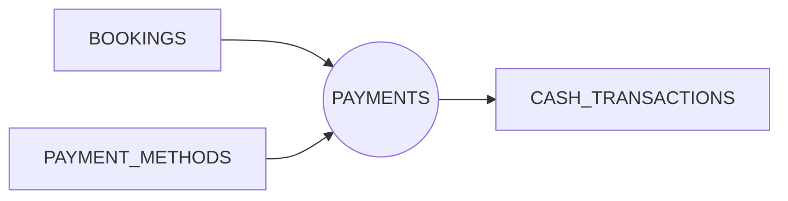

# EERD - Inheartz Studio

**Enhanced Entity Relationship Diagram** untuk backend Laravel 12 (MySQL). Dokumen ini memperluas ERD biasa dengan konsep EER: **generalisasi/spesialisasi**, **entitas lemah (weak entity)**, **agregasi**, serta **atribut multinilai/turunan**. Struktur fisik mengikuti migrasi di `be_photograph/database/migrations`.

> **Versi Dokumen: 0.2.1**

- Versi **dbdiagram.io (DBML)**: [diagrams/erd.dbml](./diagrams/erd.dbml)
- Dokumen terkait: [prd.md](./prd.md), [README.md](./README.md).

## 1. Diagram EER Utama

## 2. Generalisasi / Spesialisasi

Entitas `USERS` merupakan **superclass** yang dispesialisasi (disjoint) berdasarkan atribut pembeda `role`. Di level konseptual EER ketiganya adalah subkelas; pada implementasi fisik tetap satu tabel `users` (single-table inheritance).

**Aturan EER:**
- **Disjoint constraint**: satu user hanya menempati satu subkelas (`role` tunggal).
- **Total specialization**: setiap user wajib memiliki salah satu `role` (default `client`).
- Relasi yang melibatkan subkelas tetap merujuk ke `USERS` (foreign key ke `users.id`).

## 3. Entitas Lemah (Weak Entity)

Entitas yang keberadaannya bergantung (existence dependency) pada entitas induk melalui relasi identifikasi:

- **`BOOKING_PROGRESS`** — lemah terhadap `BOOKINGS`; riwayat tahapan tidak bermakna tanpa booking induk. PK fisik tetap `id`, tetapi identitas logisnya ditentukan oleh `booking_id` + `created_at`.
- **`CASH_TRANSACTIONS`** — catatan kas masuk/keluar terikat pada booking (unik pada `booking_id`, `type`).

**Aturan EER:**
- Relasi identifikasi bersifat **total**: `booking_id` wajib terisi (NOT NULL) pada `booking_progress`; pada `cash_transactions` boleh `null` hanya untuk kas manual di luar booking.
- Penghapusan booking induk sebaiknya membatasi/menghapus entitas lemah (`cascade`/`restrict`).

## 4. Agregasi

`PAYMENTS` memperlakukan pasangan `BOOKINGS` + `PAYMENT_METHODS` sebagai satu kesatuan transaksi (agregasi), karena pembayaran mengikat booking yang dibayar dan metode yang dipakai.

- `PAYMENTS` diidentifikasi oleh `booking_id` (wajib) dan opsional `payment_method_id`.
- Saat status booking `completed`, agregasi ini memicu pembuatan `CASH_TRANSACTIONS` bertipe `income`.

## 5. Atribut Multinilai & Turunan

| Entitas | Atribut | Jenis | Keterangan |
| --- | --- | --- | --- |
| `packages` | `features` | Multinilai (JSON) | Daftar fitur paket disimpan sebagai array JSON. |
| `availabilities` | `booked` | Turunan | Akumulasi jumlah booking pada slot; diturunkan dari `bookings`. |
| `availabilities` | `quota` | Batas | Kapasitas maksimum slot. |
| `bookings` | `total_price` | Turunan | Diturunkan dari `packages.price` (dan penyesuaian admin). |
| `bookings` | `production_percent` | Turunan | Diturunkan dari tahapan `booking_progress` aktif. |
| `bookings` | `revision_count` | Turunan | Jumlah revisi hasil review klien. |

## 6. Relasi & Kardinalitas

| Relasi | Kardinalitas | Keterangan |
| --- | --- | --- |
| categories → packages | 1 : N | Satu kategori memiliki banyak paket. |
| categories → portfolios | 1 : N | Satu kategori memiliki banyak item portofolio. |
| packages → portfolios | 1 : N (opsional) | Portofolio dapat ditautkan ke paket terkait. |
| packages → bookings | 1 : N | Satu paket dapat dipesan berkali-kali. |
| availabilities → bookings | 1 : N | Slot jadwal yang dipakai booking. |
| users → bookings | 1 : N (opsional) | Booking boleh tanpa login (guest), `user_id` nullable. |
| users → bookings | 1 : N (opsional) | Pekerja produksi yang ditugaskan (`assigned_to`) mengerjakan booking. |
| bookings → payments | 1 : N | Satu booking bisa punya beberapa pembayaran. |
| payment_methods → payments | 1 : N | Metode pembayaran yang dipakai (opsional). |
| users → payments | 1 : N (opsional) | Admin yang memverifikasi (`verified_by`). |
| bookings → cash_transactions | 1 : N | Kas masuk (income) saat selesai; kas keluar (expense) saat refund/chargeback. |
| bookings → booking_progress | 1 : N | Riwayat perubahan tahapan produksi per booking. |
| users → booking_progress | 1 : N (opsional) | Admin yang memperbarui tahapan produksi (`user_id`). |
| users → activity_logs | 1 : N | Log aktivitas untuk monitoring. |
| users → notifications | 1 : N | Notifikasi in-app per user (database notification Laravel). |

## 7. Detail Tabel

### users
Akun admin, pekerja produksi, & client. Kolom `role` untuk RBAC (`admin`, `production`, `client`) — dasar spesialisasi pada bagian 2. Token Sanctum disimpan di `personal_access_tokens`.

### categories / packages / portfolios
Katalog layanan. `features` pada `packages` disimpan sebagai JSON array (atribut multinilai). Kolom `is_popular` dipertahankan untuk kompatibilitas backend, tetapi sejak versi 0.1.7 tidak lagi ditampilkan di UI (badge "Populer" dihapus).

### availabilities
Slot jadwal. Kombinasi `date` + `time` unik. Endpoint `/availability?date=` membaca tabel ini. `booked` merupakan atribut turunan dari jumlah booking aktif.

### bookings
Data inti pemesanan. `booking_code` format `INH-YYYY-XXXX`. Alur status: `pending → awaiting_payment → paid → confirmed → ongoing → completed` (bisa `cancelled`). Kolom `admin_note` dan `drive_url` diisi admin. Kolom produksi: `production_stage` (tahapan aktif: `queued | transfer | culling | editing | review | revision | delivered`), `production_percent` (persentase), `estimated_finish`, `production_started_at`, `production_finished_at`. Kolom review/revisi: `preview_url` (tautan hasil untuk ditinjau klien), `review_status` (`pending | approved | revision`), `revision_count`.

### booking_progress (entitas lemah)
Riwayat (timeline) tahapan produksi. Setiap perubahan tahapan oleh admin menambah satu baris (`stage`, `status`, `note`, `user_id`). Dipakai halaman Progres Produksi admin dan Progress Pesanan pelanggan.

### payment_methods
Master metode pembayaran (transfer bank, VA, e-wallet, QRIS) beserta instruksi.

### payments
Transaksi pembayaran (agregasi booking + metode). Untuk Midtrans: `provider='midtrans'`, `midtrans_order_id`, `snap_token`, `snap_url`, `transaction_status`, `fraud_status`, `payload`. Status internal: `pending | verified | rejected | refunded`.

### cash_transactions (entitas lemah pada booking)
Ledger saldo studio per booking. Unik pada (`booking_id`, `type`). `income` dicatat saat booking `completed`; `expense` saat refund/chargeback.

### contact_messages
Pesan dari formulir kontak.

### activity_logs
Audit trail aksi admin/user.

### registration_otps
OTP verifikasi pendaftaran akun via WhatsApp. Menyimpan `email`, `phone`, `otp_hash`, `attempts` (maks 5), `expires_at` (10 menit), dan `used_at`. Dipakai endpoint `POST /register/request-otp` (membuat & mengirim kode) dan `POST /register` (memverifikasi kode sebelum akun dibuat).

### password_reset_otps
OTP reset password via WhatsApp. `otp_hash`, `attempts`, `expires_at`, `used_at`.

### notifications
Notifikasi in-app (Laravel database notifications, polymorphic `notifiable`). Kolom `type` berisi class notifikasi; `data` (JSON) berisi `type`, `title`, `message`, `url`, `booking_id`; `read_at` untuk status baca.

> Sejak v0.1.8, notifikasi juga mencakup **pesanan baru** (admin/staff), **perubahan status** (client), **progres produksi** (client), dan **rekomendasi paket** (client). Salinan pesan dikirim melalui **WhatsApp (Fonnte)**; rekomendasi paket dihitung dari riwayat booking/kategori/harga melalui `GET /recommendations` sehingga tidak memerlukan tabel baru.

## 8. Pemetaan Endpoint ke Tabel

| Endpoint | Method | Tabel utama |
| --- | --- | --- |
| `/login`, `/register`, `/me`, `/logout` | POST/GET | users, personal_access_tokens |
| `/register/request-otp` | POST | registration_otps |
| `/forgot-password`, `/verify-otp`, `/reset-password` | POST | password_reset_otps, users |
| `/packages`, `/packages/{slug}` | GET | packages, categories |
| `/categories` | GET | categories |
| `/portfolios`, `/portfolios/{id}` | GET | portfolios |
| `/availability?date=` | GET | availabilities |
| `/bookings`, `/bookings/{id}` | GET/POST | bookings, availabilities |
| `/payment-methods` | GET | payment_methods |
| `/payments/midtrans/charge` | POST | payments, bookings |
| `/payments/midtrans/sync` | POST | payments, bookings, cash_transactions |
| `/payments/midtrans/notification` | POST | payments, bookings, cash_transactions |
| `/payments/midtrans/status/{orderId}` | GET | payments, bookings |
| `/admin/stats`, `/admin/finance` | GET | bookings, cash_transactions |
| `/admin/bookings`, `/admin/customers`, `/admin/users` | GET | bookings, users |
| `/admin/users`, `/admin/users/{user}` | POST/PUT/DELETE | users, activity_logs |
| `/admin/production`, `/production` | GET | bookings, booking_progress |
| `/bookings/{booking}/progress` | PATCH | bookings, booking_progress |
| `/notifications`, `/notifications/{id}/read`, `/notifications/read-all` | GET/POST | notifications |
| `/contact` | POST | contact_messages |

## 9. Catatan Implementasi

- Foreign key: `payments` → `bookings` (`cascadeOnDelete`); `bookings` → `packages`/`availabilities` (`nullOnDelete`).
- Index: `bookings.status`, `bookings.booking_date`, `availabilities.date`, `payments.status`, `payments.midtrans_order_id`.
- Autentikasi memakai Laravel Sanctum (Bearer token). FE mengirim `Authorization: Bearer <token>`.
- `features` (packages) dan `meta` (activity_logs) sebagai kolom `json`.
- Spesialisasi `users.role` diimplementasikan sebagai **single-table inheritance**; subkelas pada bagian 2 bersifat konseptual untuk memudahkan pemahaman EER.
